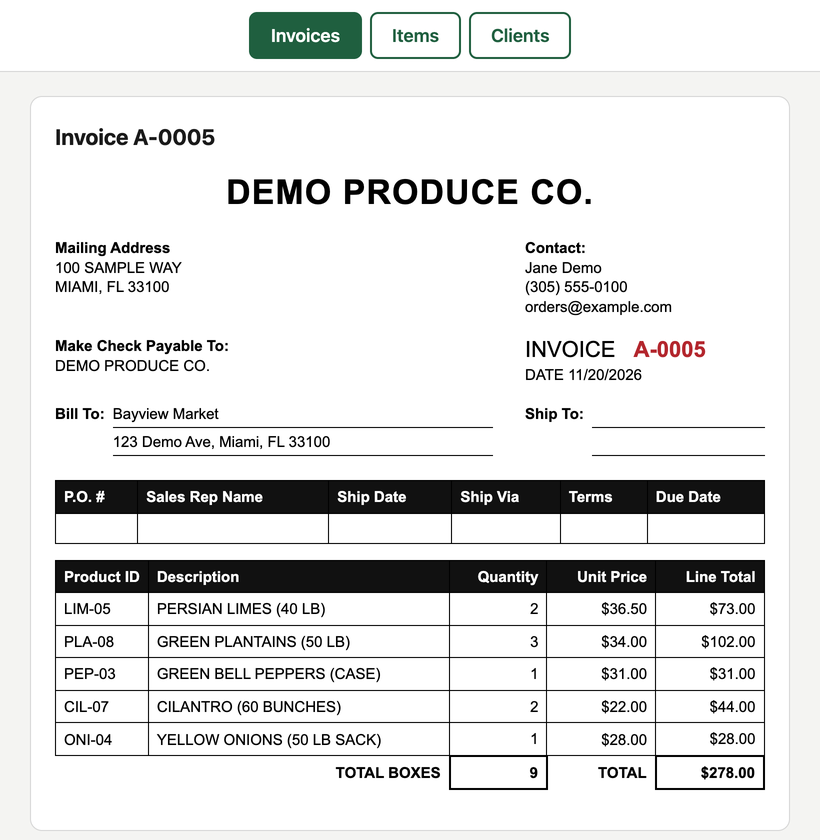
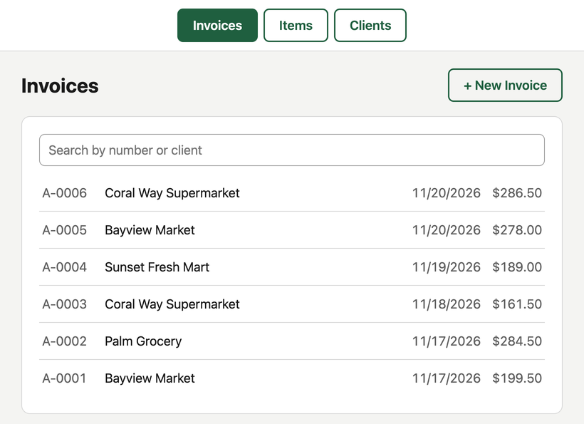
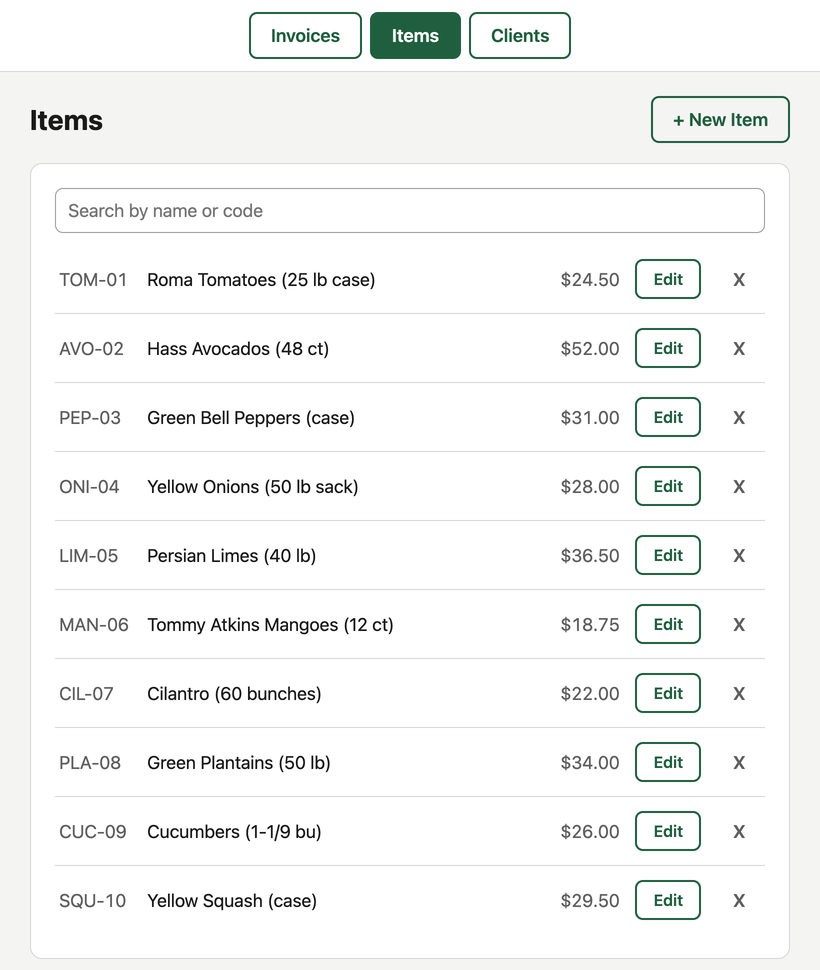
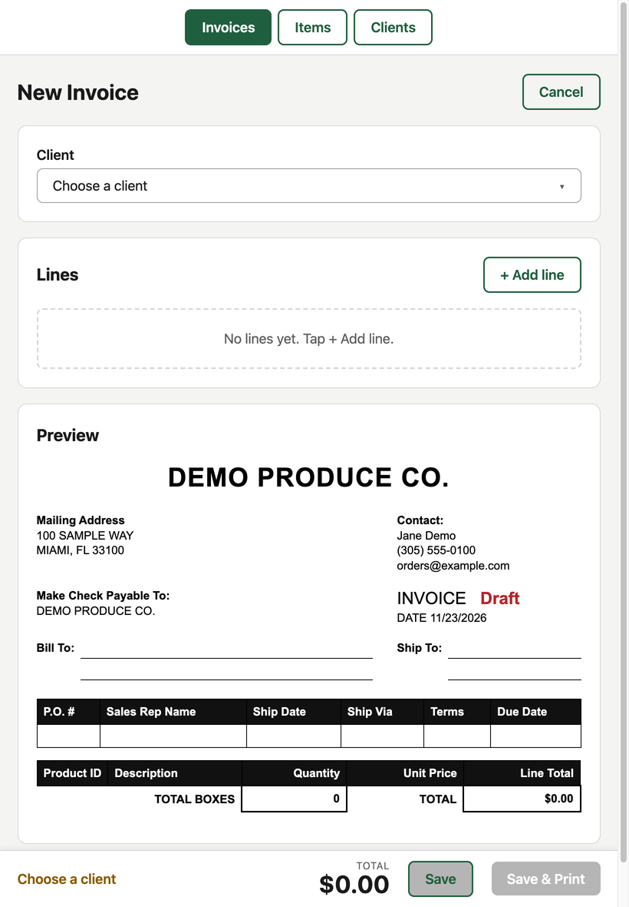
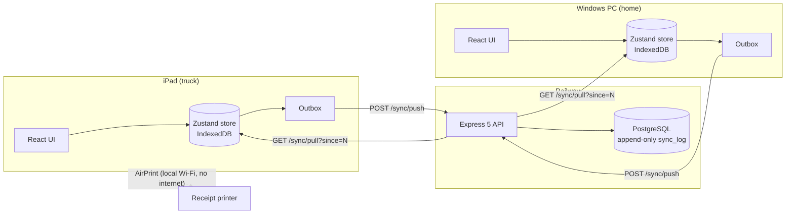
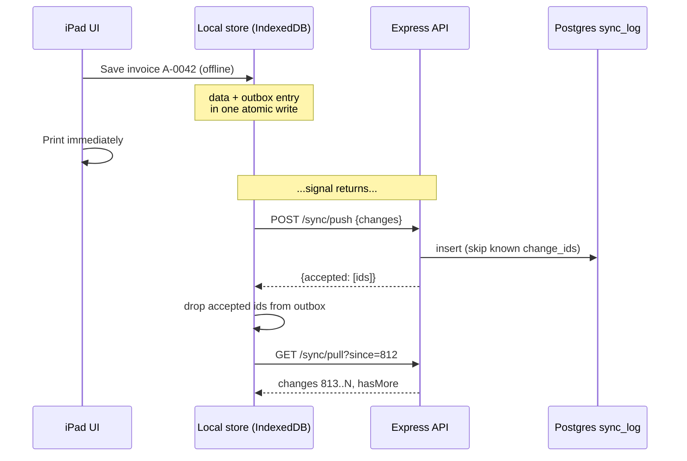

# Invoicer — Offline-First Invoicing for a Produce Wholesaler

> **Commercial client project · built for a paying client**
> Source code is private (paid client product). This repo is a write-up of the problem, the
> architecture, and the decisions behind it. **A live code walkthrough is available on request.**

| | |
|---|---|
| **Client** | A small produce wholesaler that delivers to small supermarkets by truck |
| **Role** | Sole engineer, end to end: requirements, design, build, deploy, device setup, handoff |
| **Timeline** | November 2026, about 3 weeks from first meeting to production |
| **Stack** | React 19 · TypeScript · Zustand · IndexedDB · PWA (Workbox) · Node.js · Express 5 · PostgreSQL · Drizzle · Zod · pnpm workspaces · Vercel · Railway |

<p align="center"></p>
<p align="center"><sub>All screenshots use made-up demo data. No real client, customer or pricing data is shown.</sub></p>

---

## The problem

The client buys produce from local farms and sells it to small supermarkets, delivering by
truck and getting paid in cash or check at the door. For years the invoices were handwritten.
Then several supermarkets started requiring a **printed, professional invoice handed over on
the spot**.

The constraints came from the people using it and from where they use it:

- **The users are two elderly owners who are not comfortable with technology.** I first suggested Square and Zoho, but they rejected using the apps.
- **The invoice is made and printed in the truck.** The connection drops all day: highways,
  warehouses, the back of a shopping plaza. The sale might be finished at the exact moment
  there's no signal.
- **They use two devices:** an iPad in the truck and a Windows PC at home, where they edit
  the product catalog and customer list. Both must hold the same data.

So the one requirement that shaped everything was: **the app must never wait on the
network.** Loading the catalog, building an invoice, numbering it and printing it all have
to work with zero connectivity, and everything syncs later.

## The solution at a glance

An installable web app (PWA) that opens from the iPad's home screen with no signal and
keeps a **full copy of the business's data on each device**. A background sync engine
reconciles each device with a central Postgres database whenever a connection exists.

<table><tr>
<td width="33%"><br><sub><b>Invoices</b>: newest first, searchable, tap a row to reprint</sub></td>
<td width="33%"><br><sub><b>Items</b>: the product catalog, editable on either device</sub></td>
<td width="33%"><br><sub><b>New invoice</b>: live preview; Save explains what's missing</sub></td>
</tr></table>



The UI only ever reads and writes the local store. The network is a background detail.

---

## Engineering decisions

### 1. Local-first, not "online with an offline mode"

Adding offline support to a normal REST app afterwards usually means rewriting it. So the
device is the source of truth from day one: every screen reads and writes the local
Zustand store, which is saved to IndexedDB. The server is the durable copy and the meeting
point between devices, not something the UI waits on.

The device never wipes its data after syncing. The catalog and customer list have to be
there at the next stop, which may have no signal.

### 2. A hand-rolled sync protocol (and why not WebSockets)

I looked at ready-made sync products (PowerSync, ElectricSQL, RxDB) and decided against
them. They add a hosted dependency or a heavy client library, and this schema is four
tables with two users. Hand-rolled sync stays manageable here because **invoices can never
be edited after they are issued**, which removes most of the possible conflicts.

**Outbox (device → server).** Each local change updates the data *and* adds a change record
to an `outbox` in **the same store update**, which is saved as one atomic write. The data
and its pending upload can never disagree, even if the iPad dies mid-save.

**Push.** `POST /sync/push` sends up to 200 changes per batch. Each change carries its own
UUID, and `sync_log.change_id` is unique, so a retried push after a dropped connection is
skipped rather than applied twice. **Push is idempotent.**

**Pull (server → device).** `GET /sync/pull?since=N` returns the server's append-only
`sync_log` after sequence number `N`, 500 rows per page plus `hasMore`. The cursor is a
database sequence number, not a timestamp, so **device clock drift can't cause missed
changes.**

**Conflicts.** Invoices are append-only, so two devices creating invoices offline simply
merge. Items and customers use **last-write-wins per row on a version counter**, with ties
going to whichever change the server received first. Deletes are soft (`deletedAt`
tombstones), so they sync like any other change.

**Why plain HTTP instead of WebSockets.** My previous project
([Chatrooms](https://chatrooms-mu.vercel.app)) used WebSockets with a server-side inbox for
offline users. Invoicer turns that pattern around. Here **the client** is the one who goes
offline, so the queue lives on the device. A connection that drops all day would mean a
socket constantly reconnecting, while short HTTP requests started by the client just work
whenever a signal appears.



Sync runs when the app opens, when the browser fires its `online` event, 2 seconds after
a local change, and every 60 seconds. iOS has no background sync for web apps, so it only
runs while the app is open, and the design doesn't depend on it.

### 3. Invoice numbers that can't collide offline

Two offline devices can't share one counter. I compared three options:

| Option | Verdict |
|---|---|
| Server assigns the final number on sync | ✗ The customer gets the paper *now*, so the number must be final when the invoice is created |
| Server hands out blocks of numbers in advance | ✗ Needs a reservation protocol and still fails if a device runs out while offline |
| **Each device has its own letter prefix: `A-0042`, `B-0017`** | ✓ Works fully offline and is guaranteed unique |

The server gives each device its letter the first time it signs in (A–Z, then AA…, like
spreadsheet columns). The database primary key settles the case where two devices sign in
at the same moment. A device that already holds invoices keeps the letter it has, so the
existing numbering continues.

All primary keys are **UUIDs generated on the device**, never server auto-increment, because
rows are created offline.

### 4. Invoices are immutable snapshots

Each invoice line stores a copy of the product name, code and price, and the customer's
name and address, as they were at the time of sale. That's what lets the owners freely
edit the catalog and customer list without changing invoices already printed, and it's
why a reprint matches the original exactly. Money is stored as **integer cents**
everywhere.

### 5. One set of types for client and server

A `shared/` package in a pnpm workspace holds **Zod schemas** for every entity and API
payload. The frontend uses them for form validation, and the backend uses them to validate
every sync request. TypeScript types are generated from the same schemas, so the two sides
can't drift apart.

### 6. Auth built for a device that can't afford a login wall

A device must never get logged out in the middle of a sale because the connection dropped.
Logging in returns an **opaque random token that never expires**. The server stores only
its SHA-256 hash, one row per device, and deleting that row locks out a lost iPad. Login is
rate-limited. There's no sign-up or password recovery: I create the accounts with a CLI
command.

### 7. Printing with no internet

An iPad web app can't use Bluetooth or USB, because Safari has no Web Bluetooth or Web USB.
The only way a web page on an iPad can print is AirPrint. Instead of wrapping the app in a
native shell, I worked with the client to choose an **AirPrint receipt printer that runs
its own Wi-Fi network**. The iPad joins that network, which needs no internet, and the
app prints from local data with `window.print()` and a print stylesheet. A Capacitor
wrapper or the printer maker's helper app remain as documented fallbacks.


### 8. Made for users who aren't comfortable with technology

- Pop-up forms close only with **Cancel** or **Save**, never by tapping outside, so a stray
  thumb can't lose a half-filled form.
- Large tap targets, search-as-you-type for products and customers, and "Are you sure?"
  before deleting or throwing away an unsaved invoice.
- The Save button explains what's missing ("Choose a client", "Add a line") instead of just
  being disabled.
- Price entry treats the digits typed as cents (typing `1299` shows **$12.99**), so nobody
  has to find the decimal point.
- There's no sync status on screen. The owners don't need it, and it would only worry them.

### 9. Running it like a real product

- **Delivered in small slices, each agreed with the client before I wrote code.** I demoed
  a working prototype on their iPad within the first week.
- **Updates go out with no downtime.** Vercel and Railway deploy from `main`. Database
  migrations run before the new server goes out, and every release has to work alongside
  the previous version of the other side, because the app and server can update in either
  order.
- **App updates install quietly** in the background and take effect the next time the app is
  opened. The screen never reloads mid-invoice.
- **Nightly database backups.** A scheduled Railway service runs `pg_dump` at 3 AM and keeps
  14 nights. I tested restoring into an empty database and over a changed one, and wrote
  down the recovery steps, including moving the sync counter forward so devices don't
  skip changes after a restore.
- **The owners' business details** (name, address, phone) live in the database, not the
  code. The app's code is public on the web, and their details shouldn't be.

---

## How it was verified

- Unit tests (Vitest) for the money math and every Zod schema.
- **Two separate headless Chrome profiles** standing in for the PC and the iPad, run
  through the real screens: device letters kept and assigned, offline invoices `A-0002`
  and `B-0001` created at the same time with no clash, both devices ending up with all
  invoices, and the same product edited on both devices while offline ending up identical
  on both. All 15 checks passed.
- Offline checks: server shut down and network cut, and the app still opens with its data
  and builds and prints invoices.
- A data upgrade from the pre-sync version with 450 items, migrated with a backup copy
  saved first.
- Final acceptance on the client's own iPad, installed to the home screen and opened in
  airplane mode.

## What I'd do next

- **Invoice storage at scale.** The whole local store is saved as one document. That's fine
  now, but at about 30 invoices a day each save will get slower over the months. The plan
  is to store invoices one per entry and measure save time on the real iPad to decide when.
- **Voiding invoices.** A red VOID stamp set once and synced, with nothing edited or
  hidden. It's designed and waiting for the client to ask.
- **Paid add-ons** the client can choose: PDF export and emailing, a number pad for
  quantities, simple sales reports.

---

## Repo layout (private)

```
frontend/   React 19 + Vite PWA: Zustand store, IndexedDB persistence, sync engine, UI
backend/    Express 5 + TypeScript: Drizzle schema + SQL migrations, /auth, /sync/push, /sync/pull
shared/     Zod schemas, inferred types, and money helpers imported by both
docs/       Requirements, architecture decisions, delivery plan
```

**Want to see the code?** I'm happy to share my screen and walk through the sync engine,
schema and deploy setup in an interview.

**Denis Dutka** · [GitHub](https://github.com/Axden799) · [LinkedIn](https://www.linkedin.com/in/denis-dutka-35231a20b)
